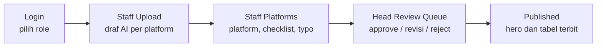

# GasKeun

Demo front-end alur persetujuan konten media sosial untuk tim desain in-house. GasKeun mensimulasikan bagaimana desainer mengunggah poster, menyiapkan caption per platform, menjalankan pemeriksaan brand, lalu mengirimkannya ke Head Designer untuk disetujui. Seluruh data berasal dari mock dan aplikasi berjalan tanpa backend, autentikasi sungguhan, router, maupun AI sungguhan.

[](https://react.dev)
[](https://www.typescriptlang.org)
[](https://vite.dev)
[](https://tailwindcss.com)
[](#8-status-proyek)

## 1. Ringkasan produk

Masalah yang disimulasikan: tim desain in-house menerima permintaan konten dari banyak kanal, menulis caption berbeda untuk tiap platform, dan harus memastikan tidak ada pelanggaran brand sebelum terbit. Di GasKeun, alur itu dipadatkan menjadi satu workspace dengan tiga peran. Klien fiktifnya adalah **Lumbung Studio** (semua email memakai domain `@lumbung.studio`), dan platform sosial yang didukung adalah Instagram, LinkedIn, dan TikTok.

| Role | Persona | Role label | Home screen |
|---|---|---|---|
| Staff | Rina Putri | Staff Designer | `staff-upload` |
| Head | Bima Santoso | Head Designer | `head-queue` |
| Admin | Ayu Lestari | Workspace Admin | `admin-dashboard` |

Persona didefinisikan di `ROLE_PROFILES` (`src/data/mockData.ts:14`). Login hanya memilih role; email dan password diabaikan.

## 2. Fitur utama per role

| Role | Fitur | Layar terkait |
|---|---|---|
| Staff | Unggah konten dan dapatkan draf AI per platform; edit caption, Regenerate, dan Save draft | `staff-upload` |
| Staff | Pilih platform dan waktu posting, jalankan checklist Brand Guardian, perbaiki typo "Aplly", lalu submit | `staff-platforms` |
| Staff | Pantau submission lewat tab All, Drafts, In review, Revision, Scheduled, dan Published | `staff-submissions` |
| Staff | Baca palet, tipografi, dan aturan brand yang dipakai pemeriksaan AI | `brand-guidelines` |
| Head | Tinjau antrean 7 item dengan filter status, pencarian, dan panel detail; aksi Approve, Request revision, Reject | `head-queue` |
| Head | Lihat hero item yang terakhir disetujui dan tabel post yang sudah terbit | `published` |
| Head | Lihat jadwal mingguan, terima saran jadwal "Gemini", dan pindahkan satu post | `head-calendar` |
| Head | Lihat beban kerja 7 desainer (hanya baca) | `head-team` |
| Admin | Pantau KPI, pipeline per status, koneksi kanal, user, dan aktivitas workspace | `admin-dashboard` |
| Admin | Ubah role user dan undang anggota baru | `admin-users` |
| Admin | Aktifkan atau nonaktifkan koneksi platform dan atur notifikasi | `admin-connected` |
| Admin | Telusuri log aktivitas dan ekspor CSV | `admin-activity` |
| Staff, Admin | Baca brand guidelines yang sama | `brand-guidelines` |

Catatan perilaku saat ini: Reject berperilaku sama dengan Request revision, dan Save draft menampilkan toast sukses tanpa menyimpan data. Keduanya tercatat di [status dan rencana](docs/status-dan-rencana.md).

## 3. Alur demo utama



1. **Login** (`login`): pilih salah satu dari tiga role. `handleSignIn` menyimpan role dan membuka home screen role tersebut.
2. **Staff Upload** (`staff-upload`): poster hiring tetap dengan draf AI untuk Instagram, LinkedIn, dan TikTok. Staff dapat mengedit caption, menekan Regenerate (bergantian antara dua set draf), atau Save draft.
3. **Staff Platforms** (`staff-platforms`): pilih platform dan waktu posting, jalankan checklist Brand Guardian, perbaiki typo "Aplly", lalu submit. Submit menimpa item `SUB-1042` di antrean Head dan menambah satu entri activity log.
4. **Head Review Queue** (`head-queue`): buka panel detail item, lalu Approve, Request revision, atau Reject. Approve memperbarui `latestApprovedItem`.
5. **Published** (`published`): hero menampilkan item yang terakhir disetujui, diikuti tabel post yang sudah terbit.

Untuk melihat layar lain, gunakan menu sidebar atau jumper "All 13 screens" di topbar.

## 4. Peta layar

Nomor di kolom "#" sama dengan `ALL_SCREENS_LIST` di `src/components/LayoutShell.tsx:63`, yang dipakai jumper "All 13 screens".

| # | ScreenId | Layar | Role | Fungsi |
|---|---|---|---|---|
| 1 | `login` | Login & role picker | Publik | Memilih role; juga bisa memasang logo kustom |
| 2 | `staff-upload` | Upload & AI draft | Staff | Draf AI per platform, edit caption, Regenerate, Save draft |
| 3 | `staff-platforms` | Platforms & check | Staff | Pilih platform dan waktu, checklist Brand Guardian, perbaiki typo, submit |
| 4 | `head-queue` | Review queue | Head | Antrean 7 item, filter, panel detail, approve/revisi/reject |
| 5 | `published` | Published | Head | Hero item terakhir yang disetujui dan tabel post terbit |
| 6 | `admin-dashboard` | Dashboard | Admin | KPI, pipeline per status, koneksi kanal, pencarian user dan aktivitas |
| 7 | `staff-submissions` | My submissions | Staff | 12 submission dan 3 draft dengan tab status serta pencarian |
| 8 | `brand-guidelines` | Brand guidelines | Staff, Admin | Palet, tipografi, dan aturan brand untuk pemeriksaan AI |
| 9 | `head-calendar` | Content calendar | Head | Jadwal tiga minggu dan saran jadwal untuk `CAL-09` |
| 10 | `head-team` | Team | Head | Beban kerja 7 desainer, hanya baca |
| 11 | `admin-users` | Users & roles | Admin | Daftar 12 user, ubah role, undang user |
| 12 | `admin-connected` | Connected accounts | Admin | Status koneksi platform dan preferensi notifikasi |
| 13 | `admin-activity` | Activity log | Admin | 24 entri log, filter, dan ekspor CSV |

Semua layar kecuali `login` dirender di dalam `LayoutShell` (sidebar dan topbar). `staff-platforms` hanya dicapai lewat alur, bukan menu sidebar.

## 5. Tangkapan layar

<table>
  <tr>
    <td align="center" valign="top"><br /><sub>Login dan pemilihan role</sub></td>
    <td align="center" valign="top"><br /><sub>Staff Upload dan draf AI</sub></td>
  </tr>
  <tr>
    <td align="center" valign="top"><br /><sub>Platforms dan checklist Brand Guardian</sub></td>
    <td align="center" valign="top"><br /><sub>Head Review Queue</sub></td>
  </tr>
  <tr>
    <td align="center" valign="top"><br /><sub>Published</sub></td>
    <td align="center" valign="top"><br /><sub>Dashboard admin</sub></td>
  </tr>
</table>

## 6. Menjalankan proyek

Prasyarat: Node 22 dan pnpm 10. Versi yang dipatok ada di `.mise.toml` (Node 22, pnpm 10.34.3). Jika memakai mise, jalankan `mise install` lebih dulu.

```bash
pnpm install
pnpm dev
```

Dev server memakai port `8443` (nilai `PORT` di `vite.config.ts:35`). Di PowerShell, untuk memakai port lain:

```powershell
$env:PORT='5173'; $env:FIGMA_DEV_SERVER_HOST='127.0.0.1'; pnpm dev
```

Perintah lain:

```bash
pnpm build                      # build produksi ke dist/
pnpm preview                    # pratinjau hasil build
pnpm exec tsc --noEmit -p .     # verifikasi tipe, wajib 0 error
```

`pnpm build` tidak menjalankan type-check, jadi `tsc` harus dijalankan terpisah. Jangan menjalankan `pnpm format`, `oxfmt`, atau formatter lain karena akan menulis ulang seluruh file.

## 7. Struktur proyek

```text
gaskeun/
├─ src/
│  ├─ App.tsx              state, handler, dan routing layar
│  ├─ main.tsx             entrypoint React
│  ├─ types.ts             tipe domain
│  ├─ index.css            font, Tailwind, kelas .gaskeun-*
│  ├─ components/
│  │  ├─ LayoutShell.tsx   sidebar, topbar, daftar 13 layar
│  │  └─ SharedUI.tsx      komponen bersama
│  ├─ data/
│  │  └─ mockData.ts       seed data dan persona
│  └─ screens/             13 layar
├─ docs/                   analisis, panduan, referensi
│  └─ assets/screenshots/  tangkapan layar
├─ public/favicon.svg
├─ index.html
├─ package.json
├─ tsconfig.json
└─ vite.config.ts
```

| Folder / file | Isi |
|---|---|
| `src/` | Seluruh kode aplikasi React dan TypeScript |
| `src/screens/` | Satu file per layar, semuanya default export |
| `src/components/` | `LayoutShell` (navigasi) dan `SharedUI` (komponen bersama, named export) |
| `src/data/` | Konstanta `INITIAL_*` dan `ROLE_PROFILES`; tidak ada data dari jaringan |
| `src/App.tsx` | Satu-satunya tempat state lintas-layar dan handler `handleX` |
| `docs/` | Dokumentasi proyek, termasuk analisis lama dan aset tangkapan layar |
| `public/` | Aset statis yang disajikan apa adanya |

## 8. Status proyek

GasKeun adalah prototipe. Login tidak memverifikasi kredensial, semua data berasal dari `src/data/mockData.ts`, dan tidak ada persistensi: setiap reload mengembalikan data ke seed. Label "Gemini" dan "Brand Guardian" adalah simulasi hard-coded. Tidak ada router, state library, test runner, maupun linter.

Lima known issue teratas:

1. Save draft tidak menyimpan draf, tetapi tetap menampilkan toast sukses.
2. Approve tidak menambah baris di Published karena dedupe berdasarkan judul, dan item tetap ada di antrean.
3. Keputusan Head tidak sampai ke My submissions, kalender, atau activity log.
4. Ekspor CSV Activity log terpotong di karakter `#` karena memakai `data:` URI dan `encodeURI`.
5. `typoFixed` adalah boolean global yang tidak pernah di-reset; submit dan approve belum dijaga oleh status typo.

Daftar lengkap, prioritas, dan rencana perbaikan ada di [status dan rencana](docs/status-dan-rencana.md), [backlog](docs/BACKLOG_HAIKU.md), dan [temuan lengkap](docs/TEMUAN_LENGKAP.md).

## 9. Dokumentasi

| Dokumen | Isi |
|---|---|
| [Indeks dokumentasi](docs/README.md) | Peta seluruh dokumen |
| [Arsitektur](docs/arsitektur.md) | Struktur aplikasi, state, aliran data, dan keputusan desain |
| [Panduan pengguna](docs/panduan-pengguna.md) | Cara memakai tiap layar per role |
| [Panduan pengembangan](docs/panduan-pengembangan.md) | Alur kerja, konvensi, dan verifikasi |
| [Referensi data](docs/referensi-data.md) | Tipe, konstanta mock, dan relasi antar dataset |
| [Referensi komponen](docs/referensi-komponen.md) | Props dan perilaku komponen bersama |
| [Status dan rencana](docs/status-dan-rencana.md) | Kondisi saat ini, known issues, dan prioritas |
| [Analisis proyek](docs/ANALISIS_PROYEK.md) | Analisis arsitektur dan aliran data |
| [Backlog Haiku](docs/BACKLOG_HAIKU.md) | 34 tugas kecil dengan kriteria terima |
| [Temuan lengkap](docs/TEMUAN_LENGKAP.md) | 187 temuan dengan `file:line` |

## 10. Kontribusi dan lisensi

Baca [CONTRIBUTING.md](CONTRIBUTING.md) sebelum mengubah kode. Ringkasnya: siapkan Node 22 dan pnpm 10, jalankan `pnpm exec tsc --noEmit -p .` sampai 0 error, lalu `pnpm build`. Jangan menjalankan formatter apa pun.

Proyek ini adalah demo internal untuk keperluan presentasi dan eksplorasi desain. Tidak ada lisensi eksplisit yang disertakan di repositori. Jangan menganggapnya sebagai proyek open source sampai pemilik menetapkan lisensi.

## Lihat juga

- [CONTRIBUTING.md](CONTRIBUTING.md)
- [AGENTS.md](AGENTS.md)
- [Indeks dokumentasi](docs/README.md)
- [Arsitektur](docs/arsitektur.md)
- [Status dan rencana](docs/status-dan-rencana.md)
