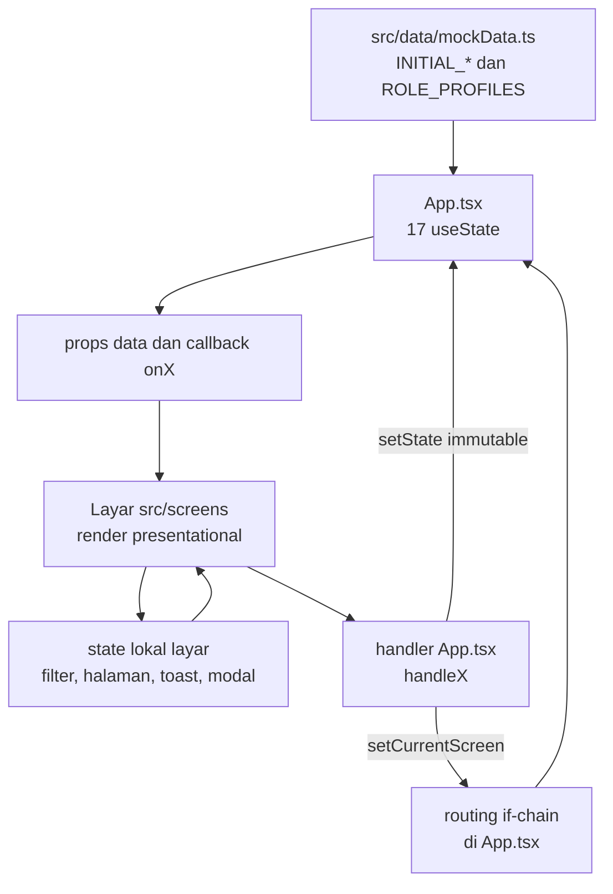
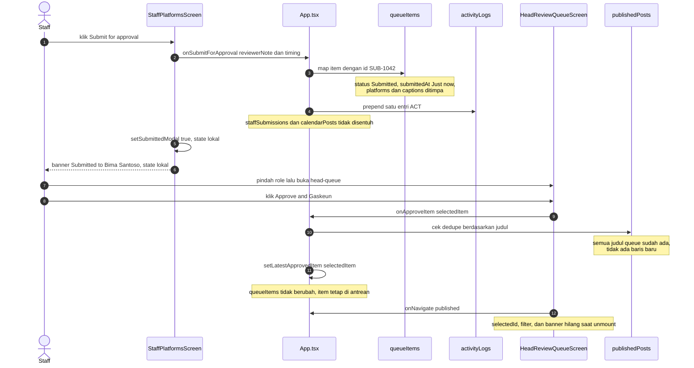

# Arsitektur GasKeun

Dokumen ini menjelaskan bagaimana aplikasi GasKeun disusun: pembagian tanggung jawab antar modul, aliran state dari data mock sampai ke layar, mekanisme navigasi, dan batas nyata antara alur yang benar-benar tersambung dan yang belum. Seluruh pernyataan di sini mengacu pada kode di `src/`, bukan pada rencana.

GasKeun adalah SPA demo tanpa backend. Tidak ada router, state library, test runner, maupun panggilan AI sungguhan. Semua data berasal dari `src/data/mockData.ts` dan kembali ke kondisi awal setiap reload.

## 1. Prinsip arsitektur

Empat keputusan berikut menjelaskan hampir seluruh bentuk kode saat ini.

1. **SPA tanpa router.** Tidak ada URL per layar, tidak ada history, tidak ada deep link. Posisi aplikasi direpresentasikan oleh satu nilai `currentScreen: ScreenId` di `src/App.tsx:44`. Render layar memakai rantai kondisi `currentScreen === '...' && <Screen />`.
2. **State lintas-layar terpusat di `App.tsx`.** Ada 17 `useState` di `src/App.tsx:43-91`. Semua data yang harus bertahan saat berpindah layar berada di sana. Layar hanya menyimpan state yang memang boleh hilang (filter, halaman, toast, modal).
3. **Data mock adalah satu-satunya sumber.** Tidak ada fetch, tidak ada penyimpanan. Konstanta `INITIAL_*` di `src/data/mockData.ts` diimpor langsung sebagai nilai awal `useState`. Mutasi hanya terjadi di memori; reload mengembalikan semuanya.
4. **Komponen layar bersifat presentational.** Layar menerima data lewat props dan mengirim niat lewat callback berprefix `on` (`onNavigate`, `onApproveItem`, dan seterusnya). Layar tidak mengimpor `mockData` untuk data yang sudah dimiliki App, dan tidak menulis state milik App secara langsung.

Konsekuensi langsung dari prinsip keempat: satu-satunya cara sebuah layar mengubah data global adalah memanggil handler yang diteruskan `App.tsx`. Kalau sebuah tombol tidak memanggil handler, tombol itu tidak mengubah data apa pun, sekalipun menampilkan toast sukses.

## 2. Peta modul dan tanggung jawab

| Modul | Tanggung jawab | Batas |
|---|---|---|
| `src/main.tsx` | Mount `App` ke `#root`, impor `index.css` | Tidak menyimpan state |
| `src/App.tsx` | 17 state, 14 handler, routing if-chain, komposisi props | Satu-satunya pemilik data lintas-layar |
| `src/types.ts` | `Role`, `ScreenId`, `PlatformName`, `SubmissionStatus`, dan interface domain | Tanpa nilai runtime |
| `src/data/mockData.ts` | `ROLE_PROFILES`, seluruh `INITIAL_*`, `ALTERNATE_AI_DRAFTS` | Tanpa fungsi, tanpa validasi |
| `src/components/LayoutShell.tsx` | Sidebar, topbar, breadcrumb, jumper 13 layar, role switcher | Hanya menerima props; tidak mengubah data |
| `src/components/SharedUI.tsx` | `Instagram`, `Linkedin`, `GaskeunLogo`, `GeminiSparkleTile`, `StatusChip`, `PlatformBadge`, `PaginationBar`, `EmptyFilterState`, `PosterGraphic` | Murni presentational, tanpa state |
| `src/screens/*.tsx` | 13 layar, masing-masing dengan state lokal sendiri | Tidak boleh menjadi sumber kebenaran data lintas-layar |
| `src/index.css` | Font, Tailwind, kelas global `.gaskeun-*` | Lihat bagian 8 |

`LayoutShell` dan `SharedUI` memakai named export, sedangkan layar memakai default export. Pola ini disengaja dan harus diikuti.

## 3. Aliran state

Aliran standar satu arah: data mock menjadi nilai awal state, state diteruskan sebagai props, layar memanggil handler, handler menulis state baru, lalu React merender ulang.



Poin penting yang sering terlewat:

- Panah `E --> D` tidak pernah menyeberang ke layar lain. State lokal mati bersama komponennya.
- Panah `F --> B` selalu mengganti objek atau array, bukan memutasi. Contoh: `setQueueItems((prev) => prev.map(...))` di `src/App.tsx:141`.
- Tidak ada panah dari `D` langsung ke `B` pada alur normal. Tiga prop meneruskan setter mentah: `onSelectRole` (`LoginScreen`, `StaffPlatformsScreen`), `onUploadLogo` (`LoginScreen`, `LayoutShell`), dan `onTabChange` (`StaffSubmissionsScreen`). Ketiganya adalah pengecualian yang disengaja, bukan pola umum.

## 4. Routing tanpa router

### 4.1 `ScreenId` sebagai kontrak

`ScreenId` di `src/types.ts:3-16` adalah union 13 literal: `login`, `staff-upload`, `staff-platforms`, `head-queue`, `published`, `admin-dashboard`, `staff-submissions`, `brand-guidelines`, `head-calendar`, `head-team`, `admin-users`, `admin-connected`, `admin-activity`.

Union ini dipakai di tiga tempat yang harus konsisten:

- `SCREEN_BREADCRUMBS: Record<ScreenId, ...>` di `src/components/LayoutShell.tsx:47` — `tsc` gagal kalau ada layar yang lupa didaftarkan.
- `ALL_SCREENS_LIST` di `src/components/LayoutShell.tsx:63` — sumber jumper "All 13 screens".
- `roleMenus: Record<Role, NavItem[]>` di `src/components/LayoutShell.tsx:99` — menu sidebar per role.

### 4.2 If-chain render

`App.tsx` melakukan early return untuk `login` di `src/App.tsx:266`. Layar itu sengaja tidak memakai shell. Dua belas layar lainnya dirender di dalam `<LayoutShell>` lewat blok `{currentScreen === '...' && (...)}` pada `src/App.tsx:288-382`. Hanya satu blok yang benar-benar menghasilkan elemen pada satu waktu; sisanya bernilai `false`.

Karena tidak ada router, tidak ada hal berikut: URL yang bisa dibagikan, tombol back browser, refresh yang mempertahankan layar, atau guard akses. Role apa pun dapat membuka layar apa pun lewat jumper.

### 4.3 `handleNavigate`

```ts
const handleNavigate = (screen: ScreenId, options?: { staffTab?: string }) => {
  if (options?.staffTab) setActiveStaffTab(options.staffTab);
  setCurrentScreen(screen);
  window.scrollTo({ top: 0, behavior: 'smooth' });
};
```

Lokasi: `src/App.tsx:100`. Opsi `staffTab` hanya dikirim oleh dua `subAction` di sidebar (`src/components/LayoutShell.tsx:113` dan `:121`). Layar menerima prop bertipe `(screen: ScreenId) => void`, sehingga layar tidak dapat meneruskan `staffTab`; ini keterbatasan tipe yang sudah tercatat di backlog (T17).

### 4.4 `handleSelectRole` versus `setCurrentRole`

Ada dua jalur pergantian role dengan arti berbeda:

| Jalur | Nilai yang diteruskan | Efek | Pemakai |
|---|---|---|---|
| `handleSelectRole` | fungsi di `src/App.tsx:93` | `setCurrentRole(role)`, lalu `setCurrentScreen(ROLE_PROFILES[role].homeScreen)` bila `currentScreen !== 'login'` | `LayoutShell` (role switcher, jumper, pill koneksi, notifikasi) |
| `setCurrentRole` mentah | setter `useState` | Hanya mengganti role; layar tidak berpindah | `LoginScreen` (`onSelectRole`), `StaffPlatformsScreen` (`onSelectRole`) |

Karena `LayoutShell` tidak pernah dirender saat `currentScreen === 'login'`, kondisi di `handleSelectRole` selalu benar pada pemakaian nyatanya. Efeknya: memilih role dari sidebar langsung membuka home screen role tersebut.

`StaffPlatformsScreen` memakai setter mentah, jadi ia wajib memanggil `onNavigate` sendiri. Pola itu terlihat di stepper dan banner submit (`src/screens/StaffPlatformsScreen.tsx:118-119` dan `:157-158`): `onSelectRole('Head')` lalu `onNavigate('head-queue')`.

Jumper dan notifikasi memakai urutan yang sama. Urutan itu hanya benar karena React menggabungkan kedua update dalam satu render; `handleSelectRole` menulis `currentScreen` ke home role, lalu `handleNavigate` menimpanya dengan layar tujuan.

### 4.5 Konsekuensi unmount

Setiap perpindahan layar meng-unmount layar sebelumnya. State lokalnya hilang tanpa peringatan:

- `HeadReviewQueueScreen`: `selectedId` kembali ke `items[0].id` (`SUB-1042`), `search`, `statusFilter`, `designerFilter`, `currentPage`, `captionsOpen`, `revisionBoxOpen`, `revisionNoteInput`, dan `feedbackBanner` kembali ke awal.
- `StaffSubmissionsScreen`: `search`, `platformFilter`, `typeFilter`, dan `currentPage` hilang; `activeTab` dipulihkan dari prop `initialTab` yang berasal dari `activeStaffTab`.
- `StaffPlatformsScreen`: `timing`, `scheduleDate`, `reviewerNote`, dan `submittedModal` hilang, sehingga banner sukses tidak bertahan setelah navigasi.
- `StaffUploadScreen`: `activePlatform`, `newHashtag`, `fileIndex`, dan `toastMsg` hilang.
- `HeadCalendarScreen`: `suggestionApplied` kembali `false`, meskipun `calendarPosts` sudah berubah. Tombol saran bisa ditekan lagi.
- `AdminActivityLogScreen`: `exportedToast` hilang.
- `LoginScreen`: `email` dan `password` kembali ke nilai awal.

Data yang diangkat ke `App.tsx` — `drafts`, `typoFixed`, `selectedPlatforms`, `activeStaffTab`, dan seluruh dataset — bertahan karena hidup di komponen yang tidak pernah unmount selama sesi.

## 5. State di `App.tsx`

Tabel berikut memuat seluruh 17 `useState` di `src/App.tsx:43-91`, tanpa sampel.

| # | State | Tipe | Nilai awal | Konsumen | Mutator |
|---|---|---|---|---|---|
| 1 | `currentRole` | `Role` | `'Staff'` | `LayoutShell` (profil, menu, breadcrumb), `LoginScreen` (`selectedRole`) | `handleSelectRole`, `handleSignIn`, `setCurrentRole` mentah dari `LoginScreen` dan `StaffPlatformsScreen` |
| 2 | `currentScreen` | `ScreenId` | `'login'` | `App` (if-chain), `LayoutShell` (breadcrumb, jumper, status nav aktif) | `handleNavigate`, `handleSignIn`, `handleSelectRole` |
| 3 | `customLogoUrl` | `string \| null` | `null` | `LoginScreen`, `LayoutShell` (`GaskeunLogo`) | `setCustomLogoUrl` lewat prop `onUploadLogo` di kedua layar |
| 4 | `drafts` | `Record<PlatformName, PlatformDraft>` | `INITIAL_AI_DRAFTS` | `StaffUploadScreen`, `handleSubmitForApproval` | `handleUpdateDraft`, `handleRegenerateDraft` |
| 5 | `useAltDraft` | `Record<PlatformName, boolean>` | semua `false` | Hanya `handleRegenerateDraft` (tidak pernah diteruskan ke layar) | `handleRegenerateDraft` |
| 6 | `typoFixed` | `boolean` | `false` | `StaffUploadScreen`, `StaffPlatformsScreen`, `HeadReviewQueueScreen`, `PublishedScreen` | `setTypoFixed(true)` lewat `onFixTypo`; tidak pernah di-reset |
| 7 | `selectedPlatforms` | `PlatformName[]` | `['Instagram', 'LinkedIn']` | `StaffPlatformsScreen`, `handleSubmitForApproval` | `handleTogglePlatform` |
| 8 | `queueItems` | `QueueItem[]` | `INITIAL_QUEUE_ITEMS` | `HeadReviewQueueScreen` | `handleSubmitForApproval`, `handleUpdateQueueItemStatus`, `handleRejectItem` |
| 9 | `publishedPosts` | `PublishedPostItem[]` | `INITIAL_PUBLISHED_POSTS` | `PublishedScreen` | `handleApproveItem` (hanya bila judul belum ada) |
| 10 | `latestApprovedItem` | `QueueItem` | `INITIAL_QUEUE_ITEMS[0]` | `PublishedScreen` (hero dan poster) | `handleApproveItem` |
| 11 | `staffSubmissions` | `StaffSubmissionItem[]` | `INITIAL_STAFF_SUBMISSIONS` | `StaffSubmissionsScreen` | `setStaffSubmissions((prev) => [...prev])` di prop `onSaveDraft`; no-op |
| 12 | `activeStaffTab` | `string` | `'All'` | `LayoutShell` (status nav aktif), `StaffSubmissionsScreen` (`initialTab`) | `handleNavigate` dengan `options.staffTab`, `setActiveStaffTab` lewat `onTabChange` |
| 13 | `calendarPosts` | `CalendarPostItem[]` | `INITIAL_CALENDAR_POSTS` | `HeadCalendarScreen` | `handleApplyCalendarSuggestion` |
| 14 | `teamDesigners` | `TeamDesignerItem[]` | `INITIAL_TEAM_DESIGNERS` | `HeadTeamScreen` | Tidak ada setter |
| 15 | `usersList` | `MemberUserItem[]` | `INITIAL_USERS_LIST` | `AdminUsersScreen`, `AdminDashboardScreen` | `handleChangeUserRole`, `handleInviteUser` |
| 16 | `connectedPlatforms` | `Record<PlatformName, boolean>` | `{ Instagram: true, LinkedIn: true, TikTok: false }` | `AdminConnectedScreen`, `AdminDashboardScreen` | `handleToggleConnect` |
| 17 | `activityLogs` | `ActivityLogEntry[]` | `INITIAL_ACTIVITY_LOG` | `AdminActivityLogScreen`, `AdminDashboardScreen` | `handleSubmitForApproval` (prepend satu entri) |

Catatan yang tidak terlihat dari tabel:

- `teamDesigners` sengaja tanpa setter; layar Head Team hanya baca.
- `staffSubmissions` praktis konstan. Satu-satunya penulisan menghasilkan array baru dengan isi identik, sehingga referensi berubah tetapi data tidak.
- `latestApprovedItem` bertipe non-null sejak awal, sehingga `PublishedScreen` selalu punya hero meski belum ada approve pada sesi berjalan.

## 6. Handler di `App.tsx`

Empat belas fungsi `handleX` ditambah lima callback inline. Semua nama di bawah persis seperti kode.

| Nama | Signature | Efek | Layar pemanggil |
|---|---|---|---|
| `handleSelectRole` | `(role: Role) => void` | Set role; bila bukan di `login`, pindah ke `ROLE_PROFILES[role].homeScreen` | `LayoutShell` (role switcher, jumper, pill koneksi, notifikasi) |
| `handleNavigate` | `(screen: ScreenId, options?: { staffTab?: string }) => void` | Set `activeStaffTab` bila ada, set `currentScreen`, scroll ke atas | `LayoutShell`; `StaffUploadScreen`, `StaffPlatformsScreen`, `HeadReviewQueueScreen`, `StaffSubmissionsScreen`, `HeadTeamScreen`, `AdminDashboardScreen` |
| `handleSignIn` | `(role: Role, targetScreen: ScreenId) => void` | Set role dan layar tujuan, scroll ke atas | `LoginScreen` |
| `handleUpdateDraft` | `(platform: PlatformName, updated: Partial<PlatformDraft>) => void` | Merge dangkal satu draf platform | `StaffUploadScreen` (judul, caption, tambah/hapus hashtag) |
| `handleRegenerateDraft` | `(platform: PlatformName) => void` | Balik `useAltDraft[platform]`, ganti draf dengan `ALTERNATE_AI_DRAFTS` atau `INITIAL_AI_DRAFTS` | `StaffUploadScreen` |
| `handleTogglePlatform` | `(plat: PlatformName) => void` | Tambah/hapus platform dari `selectedPlatforms` | `StaffPlatformsScreen` |
| `handleSubmitForApproval` | `(note: string, timing: 'immediate' \| 'schedule') => void` | Timpa item `SUB-1042`, prepend satu `ActivityLogEntry` | `StaffPlatformsScreen` (`handleSubmit`) |
| `handleUpdateQueueItemStatus` | `(id: string, status: 'Submitted' \| 'In review' \| 'Revision', note?: string) => void` | Set status item; `note` baru dipakai bila truthy, jika tidak catatan lama dipertahankan | `HeadReviewQueueScreen` (`handleSendRevision`) |
| `handleApproveItem` | `(item: QueueItem) => void` | Set `latestApprovedItem`; sisipkan baris Published hanya bila judul belum ada | `HeadReviewQueueScreen` (tombol Approve) |
| `handleRejectItem` | `(id: string) => void` | Set status item menjadi `'Revision'` tanpa catatan | `HeadReviewQueueScreen` (`handleReject`) |
| `handleApplyCalendarSuggestion` | `() => void` | Ubah `CAL-09` menjadi `dayIndex: 1`, `time: '19:00'`, `status: 'Scheduled'` | `HeadCalendarScreen` |
| `handleChangeUserRole` | `(id: string, newRole: Role) => void` | Ganti `role` satu user di `usersList` | `AdminUsersScreen` |
| `handleInviteUser` | `(email: string, role: Role) => void` | Bentuk nama dan inisial dari email, prepend user baru berstatus `'Invite pending'` | `AdminUsersScreen` |
| `handleToggleConnect` | `(platform: PlatformName) => void` | Balik nilai boolean satu platform | `AdminConnectedScreen`, `AdminDashboardScreen` |
| `onSaveDraft` (inline) | `() => void` | `setStaffSubmissions((prev) => [...prev])`; tidak menambah baris | `StaffUploadScreen` |
| `onFixTypo` (inline) | `() => void` | `setTypoFixed(true)` | `StaffPlatformsScreen` |
| `onUploadLogo` (inline) | `(url: string) => void` | `setCustomLogoUrl(url)` dari hasil `FileReader` | `LoginScreen`, `LayoutShell` |
| `onTabChange` (inline) | `(tab: string) => void` | `setActiveStaffTab(tab)` | `StaffSubmissionsScreen` |
| `onSelectRole` (inline, dua arti) | `(role: Role) => void` | `setCurrentRole` mentah di `LoginScreen` dan `StaffPlatformsScreen` | Kedua layar tersebut |

Detail `handleSubmitForApproval` yang menentukan banyak perilaku lain:

- Hanya item dengan `id === 'SUB-1042'` yang disentuh (`src/App.tsx:143`). Tidak ada item baru, tidak ada pencarian berdasarkan judul.
- Field yang ditimpa: `status: 'Submitted'`, `submittedAt: 'Just now'`, `platforms`, `captions` (selalu tiga platform dari `drafts`), dan `revisionNote` dari catatan Staff.
- `title` tidak ikut dikirim, sehingga judul hasil edit di layar Upload tidak pernah sampai ke antrean Head.
- Entri log memakai `person: 'Rina Putri'` literal dan `targetTitle: drafts.Instagram.title`.
- `staffSubmissions` dan `calendarPosts` tidak disentuh.

Detail `handleApproveItem`:

- `queueItems` tidak diubah. Item yang di-approve tetap di antrean dengan status lama dan dapat di-approve berulang kali.
- Dedupe memakai `p.title === item.title`. Ketujuh judul di `INITIAL_QUEUE_ITEMS` sudah ada di `INITIAL_PUBLISHED_POSTS`, sehingga cabang penambahan (`PUB-${900 + prev.length + 1}`) tidak pernah tercapai pada data seed.
- Tidak ada log aktivitas yang dibuat.

## 7. Aliran data nyata antar role

Bagian ini membedakan koneksi yang benar-benar ada dari yang hanya tampak ada di UI.

| Dari | Ke | Mekanisme | Status |
|---|---|---|---|
| Staff (Submit) | `queueItems` | Timpa `SUB-1042` | Tersambung, hanya satu item |
| Staff (Submit) | `activityLogs` | Prepend satu entri | Tersambung |
| Staff (Submit) | `staffSubmissions` | Tidak ada penulisan | Putus |
| Staff (Submit) | `calendarPosts` | Tidak ada penulisan | Putus |
| Head (Approve) | `latestApprovedItem` | Set objek item | Tersambung |
| Head (Approve) | `publishedPosts` | Dedupe judul | Efektif tidak menambah baris |
| Head (Approve) | `queueItems` | Tidak ada penulisan | Putus |
| Head (Revisi/Reject) | `queueItems` | Set status `'Revision'` | Tersambung, Reject sama dengan revisi |
| Head (semua keputusan) | `staffSubmissions` | Tidak ada penulisan | Putus |
| Head (semua keputusan) | `calendarPosts` | Tidak ada penulisan | Putus |
| Head (semua keputusan) | `activityLogs` | Tidak ada penulisan | Putus |
| Head (saran kalender) | `calendarPosts` | Ubah `CAL-09` | Tersambung, satu item |
| Admin (`connectedPlatforms`) | Topbar pill | Teks literal "Instagram & LinkedIn connected" | Putus |
| Admin (`usersList`) | `ROLE_PROFILES` | Tidak ada keterkaitan | Putus |
| Sidebar badge 12 / 3 / 5 | Dataset | Angka literal di `roleMenus` | Putus |
| KPI Dashboard | Dataset | `kpis` literal di layar | Putus |
| Sign out | `login` | Hanya `onNavigate('login')` | State tidak di-reset |

Implikasi yang perlu diingat saat mengubah alur:

- Satu post yang sama tampil sebagai `SUB-1042` di antrean, `MY-201` di My submissions, `CAL-06` di kalender, dan `PUB-901` di Published. Tidak ada id bersama; kaitan antar dataset hanya berupa judul dan nama.
- Karena approve tidak mengeluarkan item dari antrean dan tidak menulis ke My submissions, siklus Staff–Head tidak pernah tertutup. Perbaikan ini ada di backlog T02, T12, dan T22.
- `typoFixed` bersifat global dan tidak pernah kembali `false`, sehingga status "Fixed" bertahan untuk semua poster bertema `hiring` di seluruh sesi.

## 8. Lapisan UI dan styling

### 8.1 Tiga lapisan komponen

| Lapisan | Isi | Aturan |
|---|---|---|
| Shell (`LayoutShell`) | Sidebar 248px, topbar sticky, breadcrumb, jumper, role switcher, notifikasi, kartu user | Tidak memiliki data domain; hanya membaca props dan memanggil `onNavigate` / `onSelectRole` |
| Layar (`src/screens/*.tsx`) | Satu layar per file, layout dan interaksi lokal | Boleh punya state lokal; dilarang menjadi sumber kebenaran lintas-layar |
| `SharedUI` | Ikon brand, logo, chip status, badge platform, pagination, empty state, poster | Tanpa state; hanya menerima props |

`LayoutShell` menyimpan dua state lokal dan satu ref: `notifOpen`, `jumperOpen`, dan `logoInputRef`. Ketiganya murni urusan chrome dan hilang saat shell di-unmount (misalnya setelah sign out).

`SharedUI` tidak mengimpor `App` maupun `mockData`. `PosterGraphic` memilih tampilan dari `posterTheme`, dan prop `typoFixed` hanya berpengaruh pada tema `hiring`; tema tak dikenal jatuh ke `product`.

### 8.2 `index.css`

`src/index.css` hanya 61 baris dan memuat empat hal:

1. `@import` Google Fonts Plus Jakarta Sans sebagai baris pertama. Baris ini harus tetap di atas `@import 'tailwindcss'`.
2. `@import 'tailwindcss'`.
3. `@layer base` yang mengatur `body` (font, `#F5F7FC`, `#0B1F4D`, antialiasing).
4. Lima kelas global di luar layer: `.gaskeun-card`, `.gaskeun-btn-primary`, `.gaskeun-btn-secondary`, `.gaskeun-ai-panel`, `.gaskeun-h1`.

Tidak ada `tailwind.config`; Tailwind v4 dikonfigurasi lewat CSS bila diperlukan.

### 8.3 Kelas `.gaskeun-*` tanpa `@layer`

Kelas `.gaskeun-*` ditulis sebagai aturan biasa, bukan di dalam `@layer components`. Dalam model cascade CSS, deklarasi tanpa layer berada di atas deklarasi berlayer. Karena Tailwind menempatkan utility di layer `utilities`, aturan `.gaskeun-card` mengalahkan `bg-*` atau `border-*` yang dipasang pada elemen yang sama.

Akibat praktis:

- Menambahkan `bg-white` atau `border-[#D5DEEE]` ke elemen ber-`.gaskeun-card` tidak berefek.
- Untuk mengubah latar atau border kartu, tulis nilai langsung di kelas CSS-nya atau bungkus elemen dengan wrapper baru.
- `.gaskeun-btn-primary` mengunci `min-height: 48px`, gradien, dan bayangan. Utility tinggi tidak akan menimpanya.
- Tidak ada gaya `disabled` di kelas global. State nonaktif harus ditulis eksplisit dengan `disabled:opacity-40 disabled:pointer-events-none`.
- Karena belum berlayer, kelas ini juga mengalahkan varian `hover:` bila properti yang sama dideklarasikan. Perbaikan ke `@layer components` tercatat sebagai T03.

## 9. Alur submit dan approve

Diagram berikut menunjukkan dua alur utama beserta langkah yang hanya mengubah state lokal layar.



Langkah yang hanya mengubah state lokal: `setSubmittedModal`, banner feedback di Head Queue, `selectedId`, seluruh filter, dan `suggestionApplied` di kalender. Langkah tersebut tidak meninggalkan jejak setelah layar berpindah.

## 10. Batasan arsitektural dan utang teknis

Batasan yang bersifat struktural, bukan sekadar bug:

1. **Tidak ada identitas data bersama.** Dataset memakai id berbeda untuk entitas yang sama dan disambungkan lewat judul atau nama. Setiap perubahan judul memutus kaitan tanpa error tipe. Lihat T07 dan T22.
2. **Tidak ada lapisan domain.** Logika transisi status tersebar di handler App, layar, dan union tipe yang diduplikasi (`QueueItem.status` di `types.ts` serta salinan union di `handleUpdateQueueItemStatus` dan `HeadReviewQueueScreen`).
3. **Tidak ada guard.** Approve, revisi, submit, dan invite tidak memeriksa prasyarat. `typoFixed` tidak dijaga; submit tetap berjalan dengan nol platform terpilih karena ada fallback; approve dapat diulang pada item yang sama.
4. **Tidak ada persistensi.** Semua state hilang saat reload, termasuk `customLogoUrl` yang berupa data URL. Tidak ada `localStorage` dan tidak ada backend.
5. **Tidak ada kontrol akses.** `currentRole` hanya memengaruhi menu dan profil. Jumper dapat membuka layar role lain, dan tidak ada redirect saat role diganti.
6. **App.tsx menjadi god component.** 384 baris dengan 17 state dan 14 handler. Setiap perubahan state merender ulang seluruh pohon layar aktif.
7. **LayoutShell tidak sadar data.** Badge, "3 unread", dan pill koneksi adalah literal, sehingga tidak pernah cocok dengan state sebenarnya. Lihat T19.
8. **Dua arti `onSelectRole`.** Satu prop name menyembunyikan dua perilaku berbeda (navigasi vs set mentah). Ini sumber bug urutan pemanggilan. Lihat T17.
9. **State lokal mudah disalahartikan sebagai state global.** `suggestionApplied` di kalender dan `submittedModal` di Staff Platforms terlihat seperti status persisten padahal hilang saat unmount.
10. **Tidak ada test.** Tidak ada test runner maupun linter; verifikasi perilaku bergantung pada `tsc` dan pemeriksaan manual.

Daftar perbaikan beserta kriteria terima ada di [`BACKLOG_HAIKU.md`](./BACKLOG_HAIKU.md). Temuan rinci dengan `file:line` ada di [`TEMUAN_LENGKAP.md`](./TEMUAN_LENGKAP.md). Analisis aliran data yang lebih panjang ada di [`ANALISIS_PROYEK.md`](./ANALISIS_PROYEK.md).

## Lihat juga

- [`ANALISIS_PROYEK.md`](./ANALISIS_PROYEK.md) — analisis struktur, aliran data, dan prioritas masalah.
- [`BACKLOG_HAIKU.md`](./BACKLOG_HAIKU.md) — 34 tugas perbaikan dengan kriteria terima.
- [`TEMUAN_LENGKAP.md`](./TEMUAN_LENGKAP.md) — 187 temuan dengan lokasi `file:line`.
- [`referensi-data.md`](./referensi-data.md) — bentuk data, jumlah baris, dan relasi antar dataset.
- [`referensi-komponen.md`](./referensi-komponen.md) — props dan perilaku `LayoutShell`, `SharedUI`, dan setiap layar.
